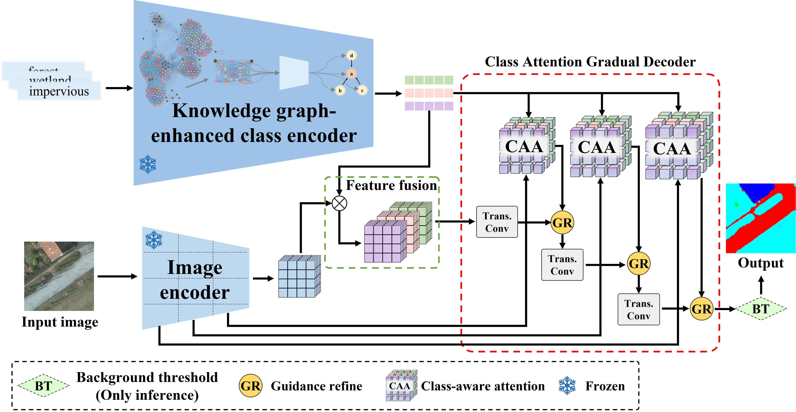
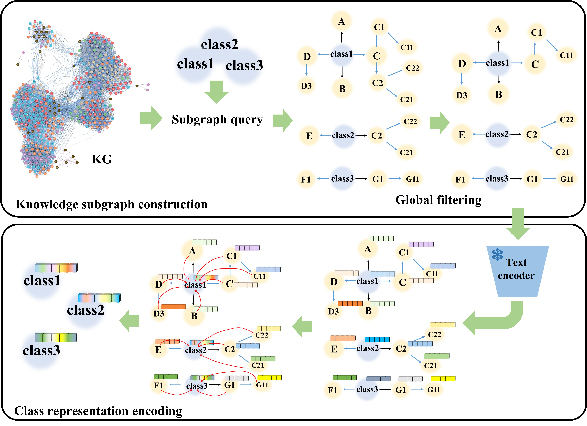
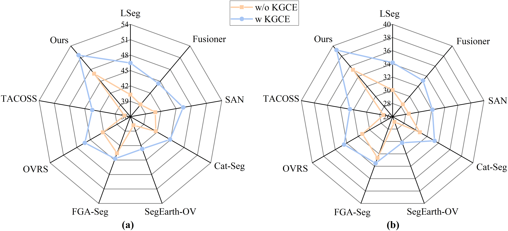
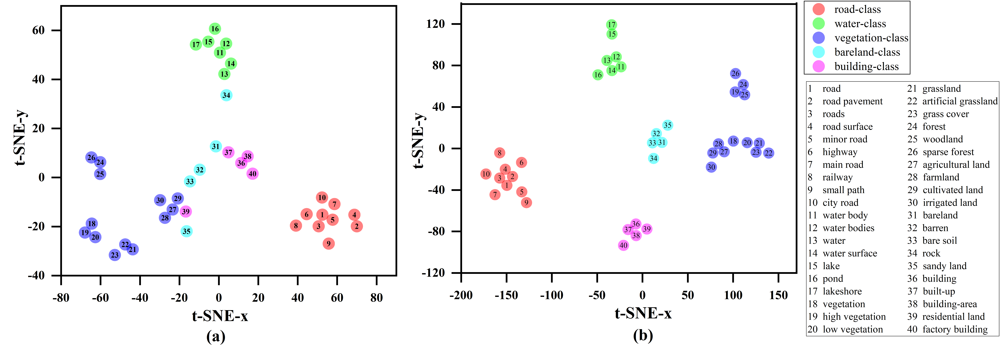

<div align="center">

<h1>Reducing Semantic Ambiguity in Open-Vocabulary Remote Sensing Image Segmentation via Knowledge Graph-Enhanced Class Representations</h1>

<div>
    <h3><strong>KG-OVRSeg</strong></h3>
</div>

<div>
    <strong>Wubiao Huang</strong>, Huchen Li, Shuai Zhang, Fei Deng*
</div>

<div>
    <h4 align="center">
        This repository is an official implementation of  <a href="https://doi.org/10.1016/j.isprsjprs.2025.11.029" target='_blank'>[Paper]</a> <a href="https://github.com/HuangWBill/KG-OVRSeg/blob/master/paper.pdf" target='_blank'>[PDF]</a>
        
    The source code is being organized and will be released as soon as possible. We appreciate your patience and interest in our work.

</h4>
</div>

</div>

[](LICENSE.Apache-2.0)

___________

## Table of Contents
* [News](#news)
* [Highlights](#highlights)
* [Overview](#overview)
* [Framework](#framework)
* [Dataset](#dataset)
* [Results](#results)
* [Visualization](#visualization)
* [Model Zoo](#model-zoo)
* [Citation](#citation)
* [Acknowledgement](#acknowledgements)
* [Contact](#contact)

___________
## News

- [2026-1-5] The **paper** has been accepted by ***ISPRS Journal of Photogrammetry and Remote Sensing (ISPRS JPRS)***.
- [2025-8-25] The work was completed.

___________
# Highlights

🔥 The first open-vocabulary remote sensing segmentation framework that explicitly addresses **semantic ambiguity** through **knowledge graph-enhanced class representations**.

✨ Proposed **Knowledge Graph-Enhanced Class Encoder (KGCE)** to improve semantic consistency of category embeddings.

✨ Designed **Class Attention Gradual Decoder (CAGD)** for progressively aligning image features with enriched class representations.

✨ Achieves new **state-of-the-art** performance on **7 remote sensing datasets**.

---

# Overview

Open-vocabulary semantic segmentation (OVSS) enables models to recognize arbitrary categories by leveraging pretrained vision-language models.

However, existing remote sensing OVSS methods directly encode class names using CLIP, leading to severe semantic ambiguity caused by

- One-to-Many Mapping
- Many-to-One Mapping
- Weak Semantic Proximity

To solve these issues, we propose **KG-OVRSeg**, which incorporates structured semantic knowledge from a **Land Cover Concept Knowledge Graph (LCCKG)** into the text encoder.

The resulting knowledge-enhanced embeddings guide the decoder through class-aware attention, significantly improving segmentation of both seen and unseen land-cover categories.

---

# Framework

<p align="center">



</p>

Our framework consists of four components

- Image Encoder
- Knowledge Graph-Enhanced Class Encoder (KGCE)
- Feature Fusion Module
- Class Attention Gradual Decoder (CAGD)

___________

## Dataset
### Knowledge Graph

This project uses our **Land Cover Concept Knowledge Graph (LCCKG)**.

The graph contains 383 land-cover concepts, 146,306 triples, can be obtained from **[LCCKG]**(https://github.com/HuangWBill/LCCKG_ERLG-update)

### Training dataset
<table>
<tr>
<th>Dataset</th><th>Class</th><th>Link</th><th>Storage path</th>
</tr>
<tr>
<td>OpenEarthMap</td><td>bareland, rangeland, developed space, road, tree, water, agriculture land, building, background</td><td> <a href="(https://open-earth-map.org" target='_blank'>[OpenEarthMap]</a></td><td>data\OpenEarthMap_512\train</td>
</tr>
</table>

### Evaluation datasets
<table>
<tr>
<th>Dataset</th><th>Class</th><th>Link</th><th>Storage path</th>
</tr>
<tr>
<td>Potsdam</td><td>impervious surfaces, building, low vegetation,tree, car, background</td><td> <a href="(https://www.isprs.org/resources/datasets/benchmarks/UrbanSemLab/Default.aspx" target='_blank'>[ISPRS]</a></td><td>data\Potsdam_512\val</td>
</tr>
<tr>
<td>LoveDA</td><td>buildings, road, water, barren, forest, agriculture, background</td><td> <a href="(https://zenodo.org/records/5706578" target='_blank'>[LoveDA]</a></td><td>data\LoveDA_512\val</td>
</tr>
<tr>
<td>GID Large</td><td>built-up, farmland, forest, meadow, water, background</td><td> <a href="(https://captain.whu.edu.cn/GID/" target='_blank'>[GID Large]</a></td><td>data\GID Large_512\val</td>
</tr>
<tr>
<td>Globe230k</td><td> cropland, forest, grass, shrubland, wetland, water, tundra, impervious, bareland, ice, background</td><td> <a href="(https://doi.org/10.5281/zenodo.8429200" target='_blank'>[Globe230k]</a></td><td>data\Globe230k_512\val_test</td>
</tr>
<tr>
<td>FLAIR #1</td><td>building, pervious surface, impervious surface, bare soil, water, coniferous, deciduous, brushwood, vineyard, herbaceous vegetation, agricultural land, plowed land, background</td><td> <a href="(https://ignf.github.io/FLAIR/" target='_blank'>[FLAIR #1]</a></td><td>data\FLAIR1_512\val</td>
</tr>
<tr>
<td>OpenEarthMap</td><td>bareland, rangeland, developed space, road, tree, water, agriculture land, building, background</td><td> <a href="(https://open-earth-map.org" target='_blank'>[OpenEarthMap]</a></td><td>data\OpenEarthMap_512\val</td>
</tr>
<tr>
<td>LandCover.ai</td><td>buildings, woodlands, water, roads, background</td><td> <a href="(https://landcover.ai/" target='_blank'>[LandCover.ai]</a></td><td>data\LandCover_ai_512\val</td>
</tr>
</table>

- The datasets used in the paper are all **publicly available** and can be downloaded and preprocessed according to the description in the paper.
- **Strictly** organize data according to the example data.
- All **background** categories in the dataset are set to **0** in the labels, while the remaining categories are numbered in order from 1 in the table above.

---


## Results

<table>
<tr>
<th rowspan=2>Method</th><th colspan=7>mF1 / mIoU (%)</th><th rowspan=2>mean mF1 (%)</th><th rowspan=2>mean mIoU (%)</th>
</tr>
<tr>
<td align="center">Potsdam</td><td align="center">LoveDA</td><td align="center">GID Large</td><td align="center">Globe230k</td><td align="center">FLAIR #1</td><td align="center">OpenEarthMap</td><td align="center">LandCover.ai</td>
</tr>
<tr>
<td align="center">LSeg</td><td align="center">45.87/34.79</td><td align="center">46.74/32.75</td><td align="center">34.88/23.53</td><td align="center">15.70/10.04</td><td align="center">24.89/16.13</td><td align="center">79.08/66.66</td><td align="center">34.81/26.24</td><td align="center">40.28</td><td align="center">30.02</td>
</tr>
<tr>
<td align="center">Fusioner</td><td align="center">39.68/28.53</td><td align="center">48.95/35.00</td><td align="center">38.01/27.72</td><td align="center">19.18/12.59</td><td align="center">19.50/13.62</td><td align="center">70.22/55.87</td><td align="center">38.08/25.61</td><td align="center">39.09</td><td align="center">28.42</td>
</tr>
<tr>
<td align="center">SAN</td><td align="center">34.65/19.52</td><td align="center">47.79/33.18</td><td align="center">41.79/28.35</td><td align="center">20.06/13.31</td><td align="center">19.78/12.93</td><td align="center">62.31/47.60</td><td align="center">60.01/44.61</td><td align="center">40.91</td><td align="center">28.50</td>
</tr>
<tr>
<td align="center">Cat-Seg</td><td align="center">40.37/29.44</td><td align="center">47.11/33.48</td><td align="center">42.14/31.80</td><td align="center">30.92/22.48</td><td align="center">24.08/16.08</td><td align="center">71.64/57.54</td><td align="center">35.58/24.48</td><td align="center">41.69</td><td align="center">30.76</td>
</tr>
<tr>
<td align="center">SegEarth-OV</td><td align="center">46.43/33.46</td><td align="center">38.84/26.45</td><td align="center">40.88/29.81</td><td align="center">28.72/19.74</td><td align="center">23.48/15.60</td><td align="center">44.50/32.07</td><td align="center">41.68/30.84</td><td align="center">37.79</td><td align="center">26.85</td>
</tr>
<tr>
<td align="center">OVRS</td><td align="center">37.28/27.16</td><td align="center">47.62/34.13</td><td align="center">42.54/32.42</td><td align="center">29.96/21.58</td><td align="center">26.97/18.12</td><td align="center">71.27/57.25</td><td align="center">39.43/28.21</td><td align="center">42.15</td><td align="center">31.27</td>
</tr>
<tr>
<td align="center">FGA-Seg</td><td align="center">42.27/30.94</td><td align="center">51.10/37.05</td><td align="center">42.32/31.42</td><td align="center">29.41/20.22</td><td align="center">27.29/19.93</td><td align="center">71.06/57.16</td><td align="center">41.86/31.87</td><td align="center">43.59</td><td align="center">32.66</td>
</tr>
<tr>
<td align="center">TACOSS</td><td align="center">34.73/24.58</td><td align="center">41.33/29.60</td><td align="center">26.31/17.13</td><td align="center">16.84/11.19</td><td align="center">19.01/13.90</td><td align="center">76.90/64.14</td><td align="center">45.08/32.26</td><td align="center">37.17</td><td align="center">27.40</td>
</tr>
<tr>
<td align="center">KG-OVRSeg</td><td align="center">53.74/40.03</td><td align="center">52.34/37.74</td><td align="center">62.51/46.93</td><td align="center">34.08/23.31</td><td align="center">26.30/19.61</td><td align="center">77.33/64.59</td><td align="center">55.27/42.03</td><td align="center">51.65</td><td align="center">39.18</td>
</tr>
</table>

---

## Visualization

<p align="center">





</p>

---

# Model Zoo

|       Backbone        | Training Dataset |  Device   | Iterations |  Checkpoint |
|:---------------------:|:----------------:|:---------:|:----------:|:----------:|
|     CLIP (ViT-B/16)     |   Official    |   -    |     -      | [Download](https://openaipublic.azureedge.net/clip/models/5806e77cd80f8b59890b7e101eabd078d9fb84e6937f9e85e4ecb61988df416f/ViT-B-16.pt) |
|     CLIP ViT-B-16     |   OpenEarthMap   | RTX4090D  |   80000    | [Open access later] |

---

# Citation

```bibtex
@article{HUANG2026837,
  title = {Reducing semantic ambiguity in open-vocabulary remote sensing image segmentation via knowledge graph-enhanced class representations},
  journal = {ISPRS Journal of Photogrammetry and Remote Sensing},
  volume = {231},
  pages = {837-853},
  year = {2026},
  issn = {0924-2716},
  doi = {https://doi.org/10.1016/j.isprsjprs.2025.11.029},
  url = {https://www.sciencedirect.com/science/article/pii/S0924271625004666},
  author = {Wubiao Huang and Huchen Li and Shuai Zhang and Fei Deng},
}
```

---

## Acknowledgements

Our implementation is built upon

- OpenMMLab
- MMSegmentation
- CLIP
- Cat-Seg

We sincerely thank the authors for making their excellent work publicly available.

---

## Contact
If you have any questions or suggestions, feel free to contact [Wubiao Huang](huangwubiao@whu.edu.cn).
